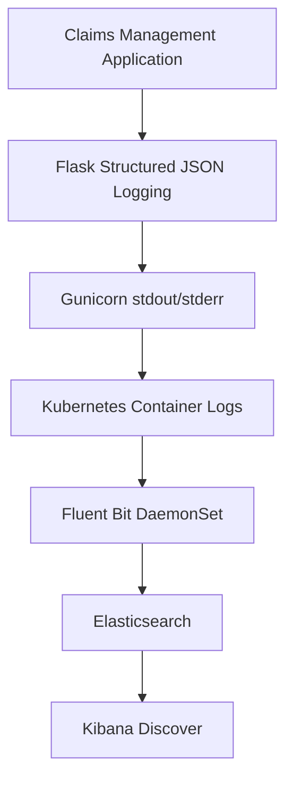

# Use Case 18 – Centralized Logging Pipeline Architecture

## 1. Document Purpose

This document describes the architecture of the centralized logging pipeline implemented for the Claims Management application.

The solution demonstrates Kubernetes container log collection, centralized log storage, log searching, failure investigation, and recovery.

## 2. Architecture Overview

The implementation uses the following components:

| Component | Technology | Responsibility |
|---|---|---|
| Application | Flask | Generates application logs |
| Application Server | Gunicorn | Runs the Flask application |
| Database | PostgreSQL | Stores application data |
| Container Orchestration | Kubernetes | Runs and manages workloads |
| Log Collector | Fluent Bit | Collects and forwards container logs |
| Log Storage | Elasticsearch | Indexes and stores log records |
| Log Visualization | Kibana | Searches and investigates logs |

## 3. Logging Data Flow

1. The Claims Management backend receives an HTTP request.
2. Flask generates a structured JSON application log.
3. Gunicorn and Flask write logs to stdout/stderr.
4. Kubernetes makes container logs available on the node.
5. Fluent Bit collects logs from Kubernetes container log files.
6. Fluent Bit enriches records with Kubernetes metadata.
7. Fluent Bit forwards records to Elasticsearch.
8. Elasticsearch stores records in date-based indices.
9. Kibana searches and displays the indexed logs.

## 4. Architecture Diagram

## 5. Component Details

### 5.1 Claims Management Backend

The backend is implemented using Flask and runs through Gunicorn.

Application logs include:

- Timestamp
- Log level
- Service name
- Message
- Request ID
- HTTP method
- Request path
- HTTP status code
- Request duration

### 5.2 Kubernetes

Kubernetes manages the application and logging workloads in the `usecase18-lab` namespace.

The backend, database, Elasticsearch, Kibana, and Fluent Bit workloads are deployed using Kubernetes manifests.

### 5.3 Fluent Bit

Fluent Bit runs as a Kubernetes DaemonSet.

Its responsibilities include:

- Reading container log files.
- Applying the CRI log parser.
- Enriching records with Kubernetes metadata.
- Forwarding records to Elasticsearch.
- Retrying failed output operations.

### 5.4 Elasticsearch

Elasticsearch acts as the centralized log destination.

The configured index prefix is:

`claims-logs`

The Logstash-style index naming convention creates date-based indices.

### 5.5 Kibana

Kibana provides the investigation interface.

Configured data view:

- Name: Claims Management Logs
- Index pattern: `claims-logs-*`
- Timestamp field: `@timestamp`

Discover is used to filter logs by container name, namespace, message, and request ID.

## 6. Network Communication

| Source | Destination | Port | Purpose |
|---|---|---:|---|
| Backend | PostgreSQL | 5432 | Database access |
| Fluent Bit | Kubernetes API | 443 | Kubernetes metadata |
| Fluent Bit | Elasticsearch | 9200 | Log forwarding |
| Kibana | Elasticsearch | 9200 | Log search |
| Browser | Kibana | 5601 | Log investigation |

## 7. Kubernetes Namespace

`usecase18-lab`

## 8. Architecture Validation

The architecture was validated by:

1. Generating a backend health request.
2. Verifying the structured log using Kubernetes logs.
3. Searching for the application log in Elasticsearch.
4. Viewing the record in Kibana.
5. Simulating an incorrect Elasticsearch hostname.
6. Restoring the original hostname.
7. Verifying a fresh request in Kibana after recovery.

## 9. Scope and Limitations

This is a local Kubernetes lab implementation.

Elasticsearch security is disabled for this environment. Fluent Bit currently uses memory-based buffering, so durable buffering across collector restarts is not guaranteed.

The architecture demonstrates centralized log collection, storage, investigation, and recovery in a controlled environment.